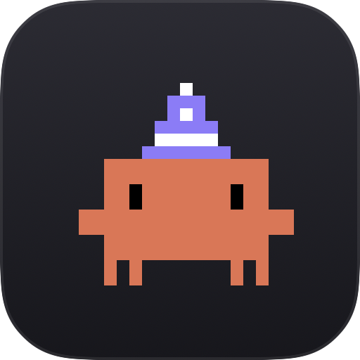
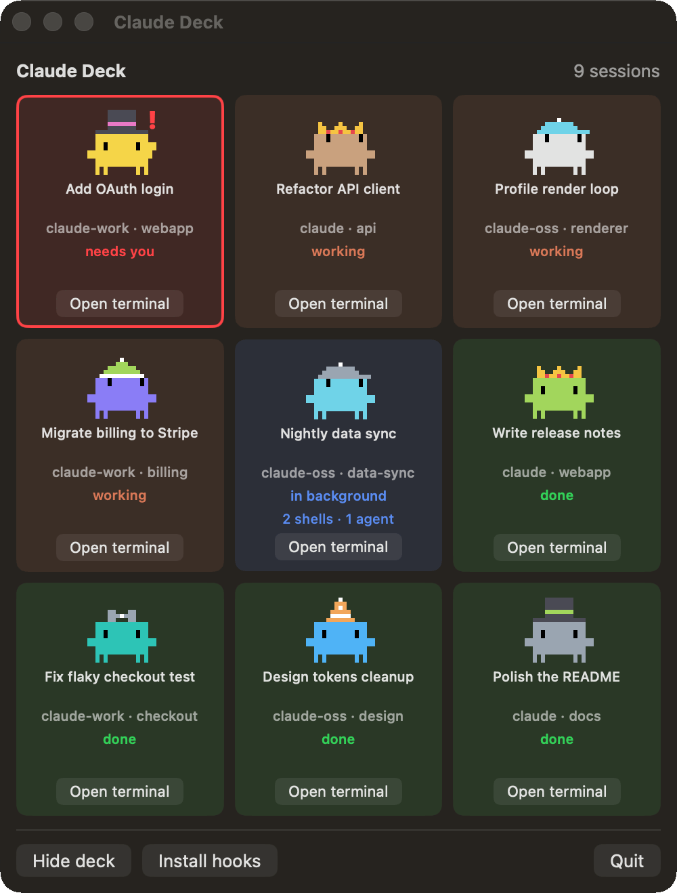
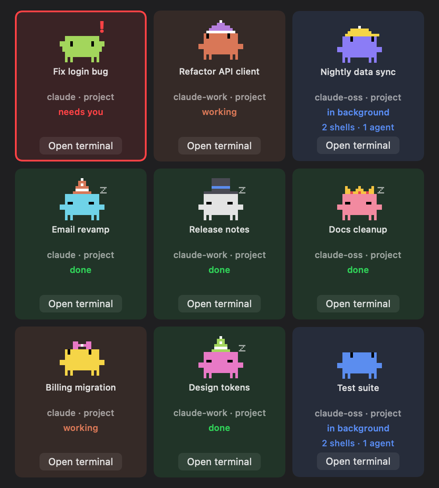

<p align="center">
  
</p>

<h1 align="center">Claude Deck</h1>

<p align="center">
  Every Claude Code session on your Mac, on one deck.<br>
  See at a glance which one is working, which one is done and which one needs you, then jump to its terminal.
</p>

<p align="center">
  
  
  
  
  <a href="LICENSE"></a>
</p>

<p align="center">
  
</p>

## Why Claude Deck

- **One place for every session.** Terminal tabs, several projects, several accounts (`claude`, `claude-work`, … set up with `CLAUDE_CONFIG_DIR`): every running session gets a card.
- **A Clawd per session.** Each session gets its own Clawd, with a color and a hat that stay the same while it runs. Its pose tells you the status.
- **Knows when it needs you.** Permission prompts, questions and plans waiting for approval jump to the top, with a red border. In the menu bar, Clawd raises its arms and shows how many.
- **Sees background work.** A session whose turn is over but still runs shells, monitors or agents shows them, so "done" really means done.
- **One click to the terminal.** **Open terminal** brings the session's tab to the front in Ghostty or Terminal.app.
- **Light and private.** Native SwiftUI, no dependencies. About 1.5% CPU and 130 MB with the deck window open. It only reads files that Claude Code already writes on your Mac, so it uses no tokens and sends nothing anywhere.

## Statuses

<p align="center">
  
</p>

| Status | Clawd | Card |
| --- | --- | --- |
| **needs you** | Waves its arms, with a "!" | Red border. A permission prompt, a question or a plan is waiting for you. |
| **working** | Hops and looks left and right | Orange |
| **in background** | Looks left and right slowly | Blue, with what still runs ("2 shells · 1 agent") |
| **done** | Stands still | Green |

Cards that need you come first, then the working ones, then the background ones, then the done ones with the most recently finished first. Each card shows the session's title: the one you set with `/rename`, else the title Claude Code generates for the conversation (the same one in the terminal tab).

Clawd is drawn from the same block glyphs and poses that Claude Code prints in the terminal. Its color comes from a 16-color palette and its hat is a party hat, cap, crown, top hat, bow, beanie or none.

## Usage

The deck lives in the menu bar as a small Clawd. Click it to open the deck.

- **Show deck** opens the same deck as a window that stays above other apps. **Hide deck** closes it. The app remembers the choice on the next launch.
- **Open terminal** on a card focuses that session's tab. The first time, macOS asks to let Claude Deck control Ghostty (or Terminal). Allow it.
- **Install hooks** sets up the Claude Code hooks that report the status (see below).
- When sessions need you, the menu bar Clawd raises its arms and shows how many.

## Build from source

You need macOS 15+ and the Xcode Command Line Tools (`xcode-select --install`). Full Xcode is not required.

```sh
git clone https://github.com/silveiralsv/claude-deck.git
cd claude-deck
./build.sh
open ClaudeDeck.app
```

Then install the hooks once, from the **Install hooks** button, or from the shell:

```sh
ClaudeDeck.app/Contents/MacOS/ClaudeDeck --install-hooks
```

This copies `scripts/hook.sh` to `~/.claude-deck/hook.sh` and adds it to the `settings.json` of each config dir. A backup goes to `settings.json.claude-deck.bak` first. Running it again does nothing. The hook prints nothing, so it adds no tokens to your sessions.

The build is signed ad hoc, so macOS can ask for the Automation permission again after a rebuild.

Run the tests with `scripts/test.sh`, and measure CPU and memory with `scripts/perf.sh` (see [CLAUDE.md](CLAUDE.md)).

## How it works

| Source | What it gives |
| --- | --- |
| `~/.claude*/sessions/<pid>.json`, written by Claude Code | The list of live sessions, their name, folder and a `busy`, `idle` or `shell` (idle with background shells) status |
| Claude Code hooks, saved by `hook.sh` to `~/.claude-deck/state/<session_id>.json` | The status: working, done, needs you |
| The end of `~/.claude*/projects/<folder>/<session_id>.jsonl`, the session transcript | The `custom-title` or `ai-title` of the session |
| Child processes of the session started through `shell-snapshots` | The background shells and monitors |
| `<session_id>/subagents/*.meta.json` next to the transcript | The background agents: unfinished, written in the last 10 minutes |
| `sysctl` on the session's pid | The session's tty |
| AppleScript | Focus the Ghostty or Terminal.app tab of that tty |

Hook events map to a status like this:

| Hook event | Status |
| --- | --- |
| `UserPromptSubmit`, `PreToolUse`, `PostToolUse` | working |
| `PreToolUse` of `AskUserQuestion` or `ExitPlanMode` | needs you |
| `Notification` (`permission_prompt`, `elicitation_dialog`) | needs you |
| `Stop`, `Notification` (`idle_prompt`) | done |
| `SessionEnd` | the state file is deleted |

Some turns fire no hook: an Esc interrupt ends one without `Stop`, and a finished background task starts one without `UserPromptSubmit`. So when the session file changed after the last hook, its `idle` or `busy` wins. A done session with background shells, monitors or agents is shown in the background.

Ghostty 1.3 does not expose the tty of a terminal over AppleScript. So the app sets the tab title to a marker through the tty, finds the Ghostty terminal with that title, puts the title back, and focuses it.

## Limitations

- `sessions/<pid>.json`, the title lines of the transcript and the subagent `meta.json` are not a documented Claude Code format. They can change in a new version.
- Ghostty's AppleScript API is a preview in 1.3 and can change in 1.4.
- Only config dirs named `~/.claude*` are found.
- iTerm2, VS Code and other terminals are not supported yet.

## Uninstall

Remove the `hook.sh` entries from the `hooks` key of your `settings.json` (or restore `settings.json.claude-deck.bak`), then delete `~/.claude-deck` and `ClaudeDeck.app`.

## Disclaimer

Claude Deck is an unofficial fan project, not made or endorsed by Anthropic. Clawd is Anthropic's mascot.

## License

[MIT](LICENSE)
