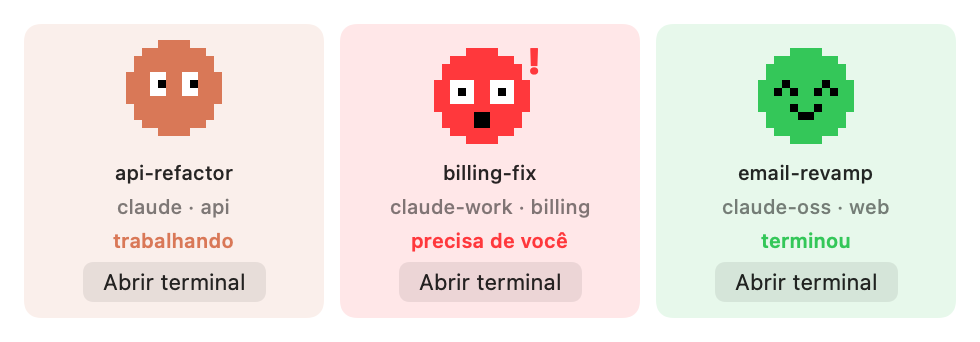

# Claude Deck

A macOS menu bar app that shows every running [Claude Code](https://claude.com/claude-code) session as a card, with a small pixel pet that tells you what the session is doing:

- **trabalhando** (working): the pet bounces and looks around
- **em segundo plano** (background): the turn is over, but shells, monitors or agents it started still run. The pet turns blue and looks around slowly, and the card counts them ("3 shells · 1 agente").
- **terminou** (done): the pet smiles
- **precisa de você** (needs you): the pet turns red and shakes. A permission prompt, a question or a plan is waiting for you.

Each card shows the session's title: the one you set with `/rename`, else the title Claude Code generates for the conversation (the same one in the terminal tab). Each card also has an **Abrir terminal** (open terminal) button that brings the session's tab to the front in Ghostty or Terminal.app.

Cards that need you come first, then the working ones, then the background ones, then the done ones with the most recently finished first.

**Exibir deck** (show deck) opens the same deck as a window that stays above other apps, so it doesn't have to live behind the menu bar icon. **Esconder deck** (hide deck) closes it. The app remembers the choice on the next launch.

It works with several Claude Code accounts at once (for example `claude`, `claude-work`, `claude-oss` set up with `CLAUDE_CONFIG_DIR`). It reads every `~/.claude*` config dir that has a `sessions` folder.

The UI is in Portuguese.



## Requirements

- macOS 15 or later
- Swift 6 or later (Xcode or only the Command Line Tools)
- Ghostty 1.3 or later, or Terminal.app

## Build and run

```sh
./build.sh
open ClaudeDeck.app
```

Then install the hooks once, from the **Instalar hooks** button in the menu, or from the shell:

```sh
ClaudeDeck.app/Contents/MacOS/ClaudeDeck --install-hooks
```

This copies `scripts/hook.sh` to `~/.claude-deck/hook.sh` and adds it to the `settings.json` of each config dir. A backup goes to `settings.json.claude-deck.bak` first. Running it again does nothing.

The first time you click **Abrir terminal**, macOS asks to let Claude Deck control Ghostty (or Terminal). Allow it. The build is signed ad hoc, so macOS can ask again after a rebuild.

## How it works

| Source | What it gives |
|---|---|
| `~/.claude*/sessions/<pid>.json`, written by Claude Code | The list of live sessions, their name, folder and a `busy`, `idle` or `shell` (idle with background shells) status |
| Claude Code hooks, saved by `hook.sh` to `~/.claude-deck/state/<session_id>.json` | The status: working, done, needs you |
| The end of `~/.claude*/projects/<folder>/<session_id>.jsonl`, the session transcript | The `custom-title` or `ai-title` of the session |
| Child processes of the session started through `shell-snapshots` | The background shells and monitors |
| `<session_id>/subagents/*.meta.json` next to the transcript | The background agents: unfinished, written in the last 10 minutes |
| `sysctl` on the session's pid | The session's tty |
| AppleScript | Focus the Ghostty or Terminal.app tab of that tty |

Hook events map to a status like this:

| Hook event | Status |
|---|---|
| `UserPromptSubmit`, `PreToolUse`, `PostToolUse` | working |
| `PreToolUse` of `AskUserQuestion` or `ExitPlanMode` | needs you |
| `Notification` (`permission_prompt`, `elicitation_dialog`) | needs you |
| `Stop`, `Notification` (`idle_prompt`) | done |
| `SessionEnd` | the state file is deleted |

Some turns fire no hook: an Esc interrupt ends one without `Stop`, and a finished background task starts one without `UserPromptSubmit`. So when the session file changed after the last hook, its `idle` or `busy` wins. A done session with background shells, monitors or agents is shown in the background.

Ghostty 1.3 does not expose the tty of a terminal over AppleScript. So the app sets the tab title to a marker through the tty, finds the Ghostty terminal with that title, puts the title back, and focuses it.

## Tests

```sh
scripts/test.sh
```

## Limitations

- `sessions/<pid>.json`, the title lines of the transcript and the subagent `meta.json` are not a documented Claude Code format. They can change in a new version.
- Ghostty's AppleScript API is a preview in 1.3 and can change in 1.4.
- Only config dirs named `~/.claude*` are found.
- iTerm2, VS Code and other terminals are not supported yet.

## Uninstall

Remove the `hook.sh` entries from the `hooks` key of your `settings.json` (or restore `settings.json.claude-deck.bak`), then delete `~/.claude-deck` and `ClaudeDeck.app`.
